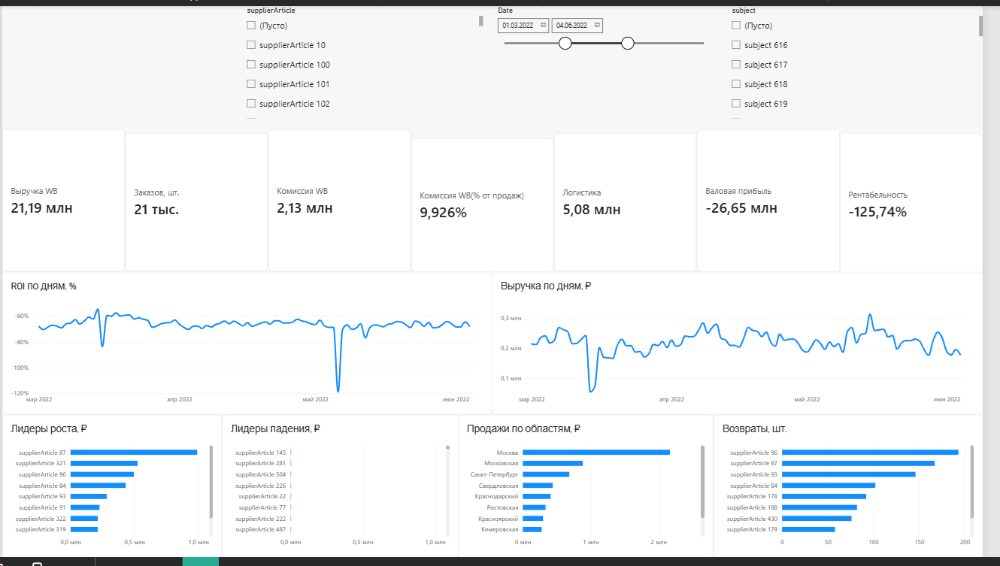

# Финансовый дашборд по продажам на Wildberries в Power BI

Тестовое задание: интерактивный отчёт по блоку «Финансы» для ИП, торгующего на WB по схеме FBS (пуховые платки и кожаные перчатки). Отчёт предназначен для собственника и закупщиков.

## Задача
Показать реальные затраты на продажи (логистика, комиссия, налоги), товары-лидеры роста и падения и продажи по регионам. Полное описание — в [docs/Описание_ТЗ.docx](docs/Описание_ТЗ.docx).

## Что реализовано

- [x] Карточки: выручка WB, заказы (шт.), комиссия WB, комиссия WB (% от продаж), логистика, валовая прибыль, рентабельность
- [x] Динамика: выручка и ROI по дням
- [x] Топы: лидеры роста и падения выручки по артикулам (сравнение с предыдущим периодом той же длины)
- [x] Продажи по областям
- [x] Лидеры возвратов
- [x] Фильтры по дате, артикулу и предмету

## Данные и модель

Факты загружаются из PostgreSQL (выгрузки Wildberries API), справочники подключаются — из Excel-файла `Справочники.xlsx` (номенклатура, себестоимость, тарифы).

| Таблица | Назначение |
|---|---|
| `public v_report_realization_full` | Отчёт о продажах по реализации: выручка, комиссия, логистика, возвраты |
| `public v_sales_full` | Продажи: цена со скидкой, к перечислению, регион |
| `public v_orders` | Заказы: количество, склад, область |
| `Справочник номенклатуры` | Артикул, предмет, категория, бренд, штрихкод, размер, цвет |
| `Себестоимость` | Себестоимость по штрихкоду |
| `Тарифы и доставка` | Комиссия и стоимость логистики по предмету |
| `Календарь` | Таблица дат |
| `Меры` | Все DAX-меры |

Связи: три таблицы фактов → `Справочник номенклатуры` по штрихкоду (многие к одному); `Справочник номенклатуры` ↔ `Себестоимость` по штрихкоду (один к одному); `Справочник номенклатуры` → `Тарифы и доставка` по предмету.

## Страницы отчёта

## DAX-меры

Полный список с пояснениями: [docs/measures.md](docs/measures.md).

## Инструменты

Power BI Desktop, DAX, Power Query, PostgreSQL.
